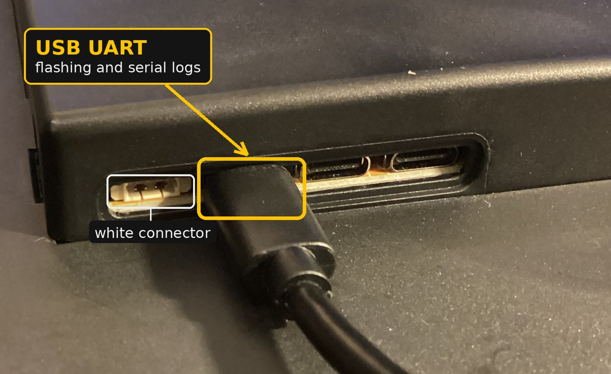

# Installation

This guide walks through installing the MiSTer Monitor **server** on your
MiSTer, the **firmware** on your display target (M5Stack Tab5, Guition
JC8012P4A1C, any of the Cheap Yellow Display variants or the Waveshare 2.8"),
and creating the free ScreenScraper account used for artwork retrieval.

> Prefer an illustrated walkthrough? The same procedure is in the setup guide
> PDF — six numbered steps from empty box to working display. It comes in two
> versions with the same content:
> **[for reading on screen](MiSTer_Monitor_Setup_Guide.pdf)**, dark like the
> display's settings page, and
> **[for printing](MiSTer_Monitor_Setup_Guide_print.pdf)**, on white pages.

## Contents

- [MiSTer side](#mister-side)
  - [Recommended: Update All or MiSTer Companion](#recommended-update-all-or-mister-companion)
  - [Alternative: MiSTer Downloader drop-in database](#alternative-mister-downloader-drop-in-database)
  - [Alternative: manual install](#alternative-manual-install)
  - [Artwork packs (optional)](#artwork-packs-optional)
- [Display side](#display-side)
  - [Recommended: Quick install (web flasher)](#recommended-quick-install-web-flasher)
    - [Guition JC8012P4A1C](#guition-jc8012p4a1c)
  - [Alternative: Building from source (advanced)](#alternative-building-from-source-advanced)
  - [Updating the firmware](#updating-the-firmware)
- [Creating a ScreenScraper account](#creating-a-screenscraper-account)
  - [Advanced: using your own developer account](#advanced-using-your-own-developer-account)
- [Enabling RetroAchievements (optional)](#enabling-retroachievements-optional)

## MiSTer side

Three installation methods are available. **Update All** or **MiSTer
Companion** is recommended: MiSTer Monitor is listed in both since Update
All 2.10, so one toggle installs the server and keeps it updated, and a
one-time setup script takes care of all the system configuration for you.
The Downloader drop-in database does the same for setups that run the
Downloader without either, and a manual install is documented last as a
fallback.

> ⚠️ **Whichever method you use: run `MiSTer_Monitor` once.**
>
> Installing the files is only half the job. **The last step of every method
> below is to run `MiSTer_Monitor` one time from the MiSTer's Scripts menu.**
> That single run enables auto-start on boot, sets `log_file_entry=1` in
> `MiSTer.ini` and starts the server.
>
> `log_file_entry=1` is what makes MiSTer report the loaded game to the
> server. Skip this step and the display will connect, show system stats and
> then sit there with **no game detection and no artwork** — the most common
> reason a fresh install appears to do nothing.

### Recommended: Update All or MiSTer Companion

1. Enable MiSTer Monitor from whichever you use:
   - **Update All** — run it from the Scripts menu, press **UP** during the
     countdown to open the settings, go to **Tools & Scripts** and enable
     **MiSTer Monitor**. Update All will offer to open the *Game Artwork
     DBs* menu at the same time — see [Artwork packs](#artwork-packs-optional)
     below; you can also come back for it later. Save.
   - **[MiSTer Companion](https://github.com/Anime0t4ku/mister-companion)**
     — open **Install Center**, find **MiSTer Monitor** and install it.
2. Let Update All (or the Downloader run that Companion triggers) finish.
   It installs these files:
   - `/media/fat/Scripts/MiSTer_Monitor.sh`
   - `/media/fat/Scripts/MiSTer_Monitor_uninstall.sh`
   - `/media/fat/Scripts/.config/mister_monitor/mister_status_server.py`
   - `/media/fat/Scripts/.config/mister_monitor/firmware/` — the display
     firmware for each board, for [updates over WiFi](#updating-the-firmware)
3. **⚠️ Required — back in the Scripts menu, run `MiSTer_Monitor` once.**
   Without this run nothing starts and no artwork is ever detected. It
   enables auto-start on boot, ensures `log_file_entry=1` in `MiSTer.ini`,
   and starts the server. You can run it again at any time; it is safe to
   repeat, and it restarts the server so a freshly downloaded update takes
   effect right away.

That's it. Future updates to the server are picked up automatically whenever
you run *Update All* or update from *MiSTer Companion* — no need to run the
setup again unless you have deactivated the monitor.

> If you installed MiSTer Monitor before 2.10 with the drop-in `.ini` below,
> keep using it or switch to the toggle, but not both: delete
> `downloader_chipster6502_MiSTer_monitor_DB.ini` from `/media/fat/` when you
> enable the toggle, so the database is not declared twice.

> **Installing Console Mode afterwards?** [Console Mode](https://github.com/Retro-Remake/ConsoleMode_Distribution)
> — Taki Udon's frontend for the SuperStation One, which also runs on any
> MiSTer — replaces
> `MiSTer.ini` with its own copy, which sets `log_file_entry` back to `0`. Run
> **`MiSTer_Monitor`** once more from the Scripts menu after installing or
> repairing Console Mode; it restores the setting and restarts the server.
> Nothing else is needed.

### Alternative: MiSTer Downloader drop-in database

For setups that run the *Downloader* on its own, without Update All. It
installs the same files and keeps them updated the same way.

1. Download the drop-in `.ini` file:

   [`downloader_chipster6502_MiSTer_monitor_DB.zip`](https://raw.githubusercontent.com/chipster6502/MiSTer_monitor_DB/db/downloader_chipster6502_MiSTer_monitor_DB.zip)

2. Extract the `.ini` from that ZIP and place it in the **root of your
   MiSTer SD card** (`/media/fat/`).
3. Run *Update All* or *Downloader* from your MiSTer Scripts menu.
   The Downloader installs these files automatically:
   - `/media/fat/Scripts/MiSTer_Monitor.sh`
   - `/media/fat/Scripts/MiSTer_Monitor_uninstall.sh`
   - `/media/fat/Scripts/.config/mister_monitor/mister_status_server.py`
   - `/media/fat/Scripts/.config/mister_monitor/firmware/` — the display
     firmware for each board, for [updates over WiFi](#updating-the-firmware)
4. **⚠️ Required — back in the Scripts menu, run `MiSTer_Monitor` once.**
   Without this run nothing starts and no artwork is ever detected. It
   enables auto-start on boot, ensures `log_file_entry=1` in `MiSTer.ini`,
   and starts the server. You can run it again at any time; it is safe to
   repeat, and it restarts the server so a freshly downloaded update takes
   effect right away.

That's it. Future updates to the server are picked up automatically whenever
you run *Update All* or *Downloader* — no need to run the setup again unless
you have deactivated the monitor. Database repository:
[chipster6502/MiSTer_monitor_DB](https://github.com/chipster6502/MiSTer_monitor_DB).

#### Uninstalling (Downloader method)

Run **`MiSTer_Monitor_uninstall`** from the Scripts menu. This *deactivates*
the monitor: it stops the server and removes the auto-start entry, but leaves
the program files in place so you can re-enable it later by running
`MiSTer_Monitor` again — no re-download needed.

To remove MiSTer Monitor **completely**, after running the uninstall script
also stop the Downloader from tracking it: disable **MiSTer Monitor** under
*Tools & Scripts* in the Update All settings or uninstall it from MiSTer
Companion's Install Center if you enabled it there, or delete the drop-in file `downloader_chipster6502_MiSTer_monitor_DB.ini` from
the root of your SD card (`/media/fat/`) if you used that route.

> `log_file_entry=1` in `MiSTer.ini` is left untouched by the uninstall
> script, because other tools may rely on it. Set it back to `0` manually if
> you want.

### Alternative: manual install

Only needed if you prefer not to use the MiSTer Downloader. Most users should
use [Update All or MiSTer Companion](#recommended-update-all-or-mister-companion)
above, which also keeps the server updated automatically.

<details>
<summary><strong>Show manual install steps</strong></summary>

1. Copy `MiSTer/Scripts/.config/mister_monitor/mister_status_server.py` to
   `/media/fat/Scripts/.config/mister_monitor/` on your MiSTer (create the
   directory if it doesn't exist).
2. Copy `MiSTer/Scripts/MiSTer_Monitor.sh` to `/media/fat/Scripts/`.
3. Add the following line to `/media/fat/linux/user-startup.sh` to launch
   the server automatically on boot:
```bash
   bash /media/fat/Scripts/MiSTer_Monitor.sh start
```
4. Enable log_file_entry in `/media/fat/MiSTer.ini` by setting (under
   the `[MiSTer]` section):
```ini
log_file_entry=1
```
This is required for the Python server to detect which core and game are
currently loaded.

With a manual install the MiSTer does not receive the display firmware, so
the display is not offered [updates over WiFi](#updating-the-firmware):
flash new versions with the web flasher instead.

</details>

### Artwork packs (optional)

The [MiSTer Artwork Pack](https://github.com/chipster6502/MiSTer_artwork_pack)
puts game images for 39 systems on the MiSTer's SD card, in three packs:

- **Box Art** — 23,658 boxes under `docs/<System>/Artwork/`, in one of
  three styles.
- **Screenshots** — 22,662 in-game screenshots under
  `docs/<System>/Screenshots/`.
- **Title Screens** — 23,204 title screens under `docs/<System>/Titles/`.

With the packs installed the server serves the image for the loaded game
directly and the display shows it without a ScreenScraper round trip, so
covered games appear at once. Games the packs do not cover, and core
images, still come from ScreenScraper, so the account below is still
needed.

Box art is what the display shows for a game by default. A screenshot or
title screen from the packs is used wherever `screenshot` or `titlescreen`
comes up in `game_media_order` or `arcade_media_order` — by default, when
the pack has no box for the game — and `image_mode=cycle` alternates the
game's screenshot, title screen and box. See
[`configuration.md`](configuration.md#the-image-screen). Each pack installs
on its own, next to the others: take box art only, or all three.

1. In the Update All settings, go to **Extra Content → Game Artwork DBs**.
   It has three entries, **Box Art**, **Screenshots** and **Title Screens**,
   each with its own list of systems. Each system is one database.
2. In **Box Art**, pick the systems you want, or **Select All**, and choose
   a style — **2D Boxes**, **3D Boxes** or **Box + Screenshot** — for the
   selected systems with **Style for Selected DBs**, or per system. Styles
   are mutually exclusive per system: switching one replaces its images on
   the next run.
3. Optionally, pick systems in **Screenshots** and **Title Screens** the
   same way. They have no style to choose.
4. Save and run Update All.

**Space on the card.** Every image occupies whole allocation blocks,
however small it is, so the packs take more room on the card than they
take to download, and how much more depends on the card's block size:
32 KB is the usual size on cards of 32 GB or less, and 128 KB the exFAT
default on larger cards.

| Pack | Download | Card, 32 KB blocks | Card, 128 KB blocks |
|---|---:|---:|---:|
| Box Art (one style) | 2.0–2.4 GB | 2.4–2.8 GB | 3.2 GB |
| Screenshots | 1.1 GB | 1.7 GB | 3.6 GB |
| Title Screens | 1.2 GB | 1.7 GB | 3.6 GB |

All three together take about 6 GB with 32 KB blocks and about 10.4 GB with
128 KB blocks. The figures per style are in the pack's
[`PACK_FORMAT.md`](https://github.com/chipster6502/MiSTer_artwork_pack/blob/main/PACK_FORMAT.md).

Nothing changes on the display side: the firmware asks the server first and
falls back to ScreenScraper on its own. Deselecting a system stops its
updates but leaves its images on the card; to delete them, highlight the
system and choose **Uninstall**.

## Display side

The display firmware can be installed two ways: the **web flasher** (easiest,
recommended) or **building from source** with the Arduino IDE.

### Recommended: Quick install (web flasher)

The fastest way to install the firmware. No Arduino IDE, no compiling.

1. Use **Google Chrome or Microsoft Edge on a desktop computer** (the flasher
   relies on Web Serial, which mobile browsers and Firefox/Safari do not
   support).
2. Connect the display to the computer with a USB cable. On the Guition, use
   the port marked **USB UART** (see [below](#guition-jc8012p4a1c)).
3. Open the flasher page:
   [https://chipster6502.github.io/MiSTer_monitor/flasher/](https://chipster6502.github.io/MiSTer_monitor/flasher/)
4. Click the **Connect** button for your display, select the serial port in
   the browser dialog, and let it flash. The page lists every supported board
   and explains how to tell the CYD variants apart (2.8" ILI9341 vs ST7789,
   and 3.5" capacitive vs resistive). It installs the latest released firmware,
   with the ScreenScraper credentials already built in. On the Waveshare 2.8",
   which has a single native USB-C port, hold **BOOT** while plugging it in if
   the flasher cannot see it.
5. Prepare the display's microSD card — formatted as **FAT32**, not exFAT —
   with `config.ini` and the asset images
   (see [`configuration.md`](configuration.md)), then insert it and power on.

> **Powering the display.** A phone charger or a powered USB hub is
> recommended rather than a USB port on the MiSTer. Depending on the setup,
> the MiSTer's ports may not supply enough current for the display's WiFi,
> which can leave it stuck on the boot screen. The display talks to the
> MiSTer over WiFi, so it does not need to be plugged into it at all.

> **Updating from an earlier version?** From 2.12.0 on, the display updates
> over WiFi, from the MiSTer. Coming from 2.11.1 or earlier, flash 2.12.0 once
> as above. See [Updating the firmware](#updating-the-firmware).

#### Guition JC8012P4A1C

**Which USB-C port.** The board has three USB-C ports side by side. Flash and
read logs through the one right next to the small white connector, labelled
*USB UART* inside the case. The other two also power the board, but the
flasher cannot connect through them.



**Which build.** Guition changes this board between batches, and the most
recent units carry a newer revision of the ESP32-P4 (v3.x) that cannot run
firmware built for the earlier one. So far they have come with a sticker SKU
ending in `-V3`, for example `10153001-V3 (2637)`, and esptool reports them as
`Chip is ESP32-P4 (revision v3.x)` when it connects. With the standard build
such a unit restarts in a loop right after flashing, and its serial log stops
after `entry 0x4ff29ed0`. Flashing the wrong build does no harm: flash the
other one.

The web flasher cannot talk to the v3 chip yet. Download
`mister_monitor_guition10inch_v3.bin` from the
[latest release](https://github.com/chipster6502/MiSTer_monitor/releases/latest)
or the flasher page, then flash it one of two ways.

**In the browser, with Espressif's own tool** (Chrome or Edge on desktop):

1. Open [espressif.github.io/esptool-js](https://espressif.github.io/esptool-js/).
2. Set **Baudrate** to **115200** before connecting. At higher rates the board
   resets when the tool switches speed.
3. Click **Connect** and pick the serial port of the USB UART connection.
4. In the **Program** section, set **Flash Address** to `0x0`, choose
   `mister_monitor_guition10inch_v3.bin` and click **Program**.
5. When it finishes, unplug the board and plug it back in.

**With [esptool](https://docs.espressif.com/projects/esptool/)**, if you have
Python: install it with `pip install esptool` and run this from the folder you
saved the file to:

```bash
esptool --chip esp32p4 write-flash 0x0 mister_monitor_guition10inch_v3.bin
```

esptool finds the port on its own; add `--port COM5` (or your port) if it
picks the wrong one.

**Before the first boot**, put these on the card (details in
[`configuration.md`](configuration.md#guition-jc8012p4a1c)):

- `panel_rev=v2` in the `[ui]` section of `config.ini`, for units from batch
  2624 onward. The batch is the figure in parentheses after the SKU on the
  sticker. Without it the screen shows horizontal colour bands instead of the
  interface. Every v3 unit needs it.
- `c6_firmware.bin` from `SD_card_content/Guition/`, in the root of the card.
  Some units ship with WiFi coprocessor firmware that lists your network but
  never connects; the display updates it from this file at boot, shows a
  progress bar and restarts once. Take the file from the same release as the
  firmware: the display refuses an image older than the one it needs.

**Power.** Use a 5 V / 2 A supply, such as a phone charger. Some MiSTer USB
ports cannot feed a 10.1" panel with WiFi: the boot animation runs, and the
board restarts as the WiFi comes up. The display talks to the MiSTer over
WiFi, so it does not need to be plugged into the MiSTer at all.

**WiFi not connecting after opening the case?** The back cover has to come off
to reach the microSD card, and the small antenna cable inside snaps off
easily. Check that it is still connected.

### Alternative: Building from source (advanced)

Only needed if you can't use the web flasher — a browser other than Chrome or
Edge on desktop, Linux, or you want to modify the firmware yourself. Most
users should use the web flasher above.

<details>
<summary><strong>Show Arduino IDE build instructions (Tab5, Guition and CYD)</strong></summary>

#### Tab5 side

##### Installing M5Stack board support in Arduino IDE

Before opening the sketch you need to register the M5Stack board package
with Arduino IDE so the Tab5 target appears in the board selector.

1. Open Arduino IDE and go to **File → Preferences**.
2. In the **Additional boards manager URLs** field, add the following URL
   (click the icon to the right of the field if you need to add it to an
   existing list):
   ```
   https://static-cdn.m5stack.com/resource/arduino/package_m5stack_index.json
   ```
3. Click **OK** to close Preferences.
4. Go to **Tools → Board → Boards Manager…**
5. Search for **M5Stack** and install the package named **M5Stack by M5Stack**.
   The installation may take a few minutes as it downloads the ESP32 toolchain.
6. Once installed, go to **Tools → Board → M5Stack** and select **M5Stack Tab5**.
7. Connect the Tab5 via USB-C, select the correct port under **Tools → Port**,
   and you are ready to upload.

##### Uploading the sketch

No credentials need to be hardcoded in the source. All configuration is read
at boot from `config.ini` on the microSD card (see
[`configuration.md`](configuration.md) for details).

1. Open `mister_monitor_Tab5/mister_monitor_Tab5.ino` in Arduino IDE.
2. Install required libraries via **Tools → Manage Libraries…**:
   - M5Unified
   - JPEGDEC
   - PNGdec

3. Select the M5Stack Tab5 board and upload.

#### Guition side

The Guition uses the standard Espressif ESP32 board package, like the CYD
boards, with the **ESP32P4 Dev Module** board and its own Tools settings.
Before building, read the [Guition section](#guition-jc8012p4a1c) above:
it explains which USB-C port to flash through and what the card needs
before the first boot (`panel_rev`, `c6_firmware.bin`).

##### Installing ESP32 board support in Arduino IDE

1. Open Arduino IDE and go to **File → Preferences**.
2. In the **Additional boards manager URLs** field, add:
   ```
   https://raw.githubusercontent.com/espressif/arduino-esp32/gh-pages/package_esp32_index.json
   ```
3. Click **OK** to close Preferences.
4. Go to **Tools → Board → Boards Manager…**
5. Search for **esp32** and install the package named **esp32 by Espressif
   Systems**, version 3.3.x (the releases are built with 3.3.12).
6. Once installed, go to **Tools → Board → ESP32 Arduino** and select
   **ESP32P4 Dev Module**.
7. Connect the board through the USB-C port marked **USB UART**, select the
   correct port under **Tools → Port**, and configure the remaining Tools
   menu options:
   - Chip Variant: `Before v3.00` for most units, or `v3.00 or newer` for a
     board with the newer ESP32-P4 (sticker SKU ending in `-V3`; esptool
     reports `revision v3.x`). The two are not interchangeable: a build for
     the wrong revision restarts in a loop right after flashing, so if that
     happens, pick the other one and upload again.
   - PSRAM: `Enabled`
   - Flash Mode: `QIO`
   - Flash Frequency: `80MHz`
   - Flash Size: `16MB (128Mb)`
   - Partition Scheme: `16M Flash (3MB APP/9.9MB FATFS)`
   - USB CDC On Boot: `Disabled`

   These are the settings the release workflow uses, as an arduino-cli FQBN:
   `esp32:esp32:esp32p4:ChipVariant=prev3,PSRAM=enabled,FlashMode=qio,FlashFreq=80,FlashSize=16M,PartitionScheme=app3M_fat9M_16MB`
   (`ChipVariant=postv3` for the v3 build).

##### Uploading the sketch

1. Open `mister_monitor_Guition10inch/mister_monitor_Guition10inch.ino` in
   Arduino IDE. The vendor display driver lives in the sketch's `src/`
   folder and is compiled with it; nothing else needs installing for it.
2. Install required libraries via **Tools → Manage Libraries…**:
   - M5GFX
   - JPEGDEC
   - PNGdec
3. Copy the contents of `SD_card_content/Guition/` — `config.ini`, the
   `cores/` images, `settings.html` and `c6_firmware.bin` — to the root of
   the Guition's microSD card, formatted as **FAT32**, not exFAT, and fill in
   your values in `config.ini` (see [`configuration.md`](configuration.md)).
4. Select the ESP32P4 Dev Module board and upload.

#### CYD side

All Cheap Yellow Display variants share the same Espressif ESP32 board
package and the same Tools settings — they differ only in which sketch folder
you open (one per panel and touch combination).

##### Installing ESP32 board support in Arduino IDE

The CYD uses the standard Espressif ESP32 board package, not the M5Stack one.

1. Open Arduino IDE and go to **File → Preferences**.
2. In the **Additional boards manager URLs** field, add:
   ```
   https://raw.githubusercontent.com/espressif/arduino-esp32/gh-pages/package_esp32_index.json
   ```
3. Click **OK** to close Preferences.
4. Go to **Tools → Board → Boards Manager…**
5. Search for **esp32** and install the package named **esp32 by Espressif Systems**.
6. Once installed, go to **Tools → Board → ESP32 Arduino** and select
   **ESP32 Dev Module**.
7. Connect the CYD via USB, select the correct port under **Tools → Port**,
   and configure the remaining Tools menu options:
   - Partition Scheme: `Minimal SPIFFS (1.9MB APP with OTA/128KB SPIFFS)`
   - Flash Size: `4MB (32Mb)`
   - PSRAM: `Disabled`
   - Upload Speed: `921600`

##### Uploading the sketch

1. Open the sketch folder for your board variant in Arduino IDE:

   | Board | Sketch folder |
   |---|---|
   | CYD 2.8" ILI9341 (ESP32-2432S028R) | `mister_monitor_CYD28R_ILI9341/mister_monitor_CYD28R_ILI9341.ino` |
   | CYD 2.8" ST7789 (ESP32-2432S028) | `mister_monitor_CYD28R_ST7789/mister_monitor_CYD28R_ST7789.ino` |
   | CYD 3.5" capacitive (ESP32-3248S035C, GT911) | `mister_monitor_CYD35C/mister_monitor_CYD35C.ino` |
   | CYD 3.5" resistive (ESP32-3248S035R, XPT2046) | `mister_monitor_CYD35R/mister_monitor_CYD35R.ino` |
   | Waveshare ESP32-S3-Touch-LCD-2.8 V2 | `mister_monitor_Waveshare28/mister_monitor_Waveshare28.ino` — different Tools settings, see [PORTING.md](PORTING.md#waveshare-esp32-s3-touch-lcd-28-v2) |

   The 2.8" variants differ only in panel controller, and the USB port count
   is a hint rather than a rule: 1 port is usually ILI9341 and 2 ports usually
   ST7789, but 2-port boards fitted with an ILI9341 do exist. A wrong pick
   costs only a re-flash — the symptom is a blank, garbled or wrong-coloured
   image — so if the picture is wrong, build the other sketch. The 3.5"
   variants share the same panel and PCB; if touch does not respond after
   flashing one, flash the other. Note that screenshot capture
   over HTTP is **not** available on the 3.5" (ST7796) boards, whose panel has
   no SPI readback.
2. Install required libraries via **Tools → Manage Libraries…**:
   - LovyanGFX
   - XPT2046_Touchscreen
   - JPEGDEC
   - PNGdec
3. Copy `config.ini` to the root of the CYD's microSD card — formatted as
   **FAT32**, not exFAT — and fill in your values
   (see [`configuration.md`](configuration.md)).
4. Copy the required asset images to the microSD card (see the
   [SD Card content](configuration.md#sd-card-content) section in
   `configuration.md`).
5. Select the ESP32 Dev Module board and upload.

</details>

### Updating the firmware

From 2.12.0 on, every release ships the display firmware to the MiSTer next
to the server, and the display installs it over WiFi:

1. Update the MiSTer with *Update All*, MiSTer Companion or the Downloader,
   then run **`MiSTer_Monitor`** once from the Scripts menu, so the new server
   is the one running.
2. The display shows a green banner for 12 seconds:
   **UPDATE TO x.y.z — TAP TO INSTALL**. Tap it. The display shows the
   progress and restarts on the new version. Nothing on the microSD card
   changes.
3. Missed the banner? The version panel on the main screen stays orange.
   Tap the main screen to bring the banner back, then tap the banner.

`http://<display-ip>:8080/update` offers the same from a browser, and
`ota_auto=true` in `config.ini` installs without a tap; both are described in
[`configuration.md`](configuration.md#firmware-updates). A download that stops
halfway or arrives damaged is discarded before it can start, and the display
keeps the version it had.

**Coming from 2.11.1 or earlier?** Those versions cannot update themselves.
Flash 2.12.0 once with the [web flasher](#recommended-quick-install-web-flasher);
your card and settings stay as they are. On the CYD boards this flash also
changes the partition layout to the two app slots an update needs, so if you
build from source, use the `Minimal SPIFFS` partition scheme listed under
[CYD side](#cyd-side). Guition units with the ESP32-P4 v3 take this flash
through esptool-js or esptool, as described [above](#guition-jc8012p4a1c).

**After updating, the card.** Your `config.ini` keeps working: options added
since then stay at their defaults until you copy them from the `config.ini`
under `SD_card_content/` for your board, or set them on the
[settings page](configuration.md#settings-page), which adds a missing key when
you set it. If your card does not have them yet, copy `cores/logo_standby.565`
from the same folder to `/cores/` on your card, and `settings.html` to its
root. On the Guition, also replace `c6_firmware.bin` in the root of the card
with the one from the new release. All of it can be done from the display's
[web interface](configuration.md#web-interface) without taking the card out.

## Creating a ScreenScraper account

The display downloads artwork from the ScreenScraper API. The app provides
its own developer credentials, so you only need a **free member account** —
no developer account or manual approval required.

1. Register for free at [https://www.screenscraper.fr](https://www.screenscraper.fr).
   Account creation is instant.
2. Take note of your username and password.
3. Enter them in `config.ini` under the `[screenscraper]` section as
   `ss_user` and `ss_pass`. See [`configuration.md`](configuration.md) for
   the configuration reference.

### Advanced: using your own developer account

If you already have your own ScreenScraper developer account and prefer to
use it (for its own quota and identity), set `ss_dev_user` and `ss_dev_pass`
in `config.ini`. When present, they override the app's built-in credentials.

## Enabling RetroAchievements (optional)

The RetroAchievements page works out of the box once the server knows your
account:

1. Create a free account at
   [https://retroachievements.org](https://retroachievements.org) if you
   don't have one.
2. Start the server once (load any game), then edit
   `/media/fat/Scripts/.config/mister_monitor/ra_credentials.ini` on the
   MiSTer — the server creates the template automatically — and fill in your
   username and **Web API key** (retroachievements.org → *Settings* →
   *Applications*).
3. Load a game with a published achievement set: the display's
   RetroAchievements page shows the set, your progress and the trophy list.

That much is **view-only**. To actually earn achievements on the MiSTer,
install the [odelot/Main_MiSTer](https://github.com/odelot/Main_MiSTer)
RetroAchievements fork and play on its `RA_`-prefixed cores; the display
detects it and unlock popups appear as they trigger. See
[`configuration.md`](configuration.md#retroachievements) for the full tier
breakdown, including the instant-popup option.
